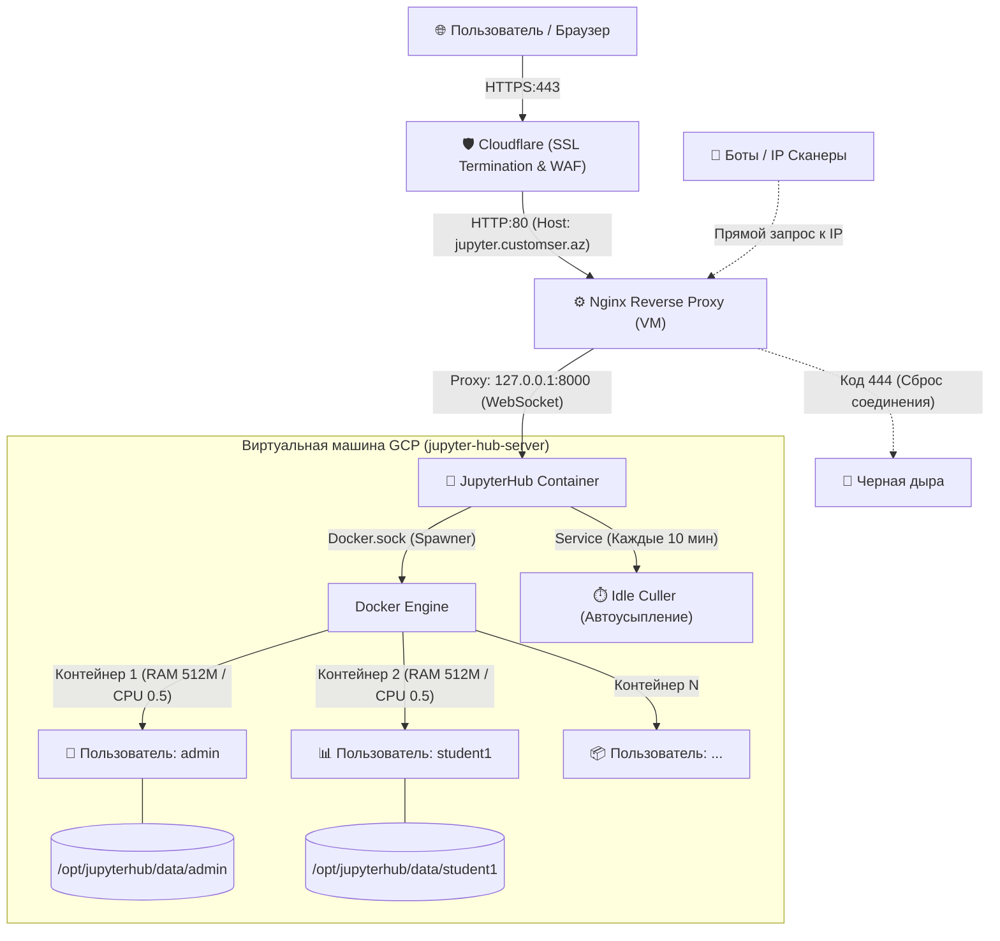

# 🚀 Production-Ready Multi-User JupyterHub on GCP

[](https://jupyter.org)
[](https://github.com/jupyterhub/dockerspawner)
[](https://jupyter.customser.az)
[](https://cloudflare.com)

Готовое, безопасное и изолированное облачное окружение JupyterHub для аналитиков, студентов и командной работы, развернутое на базе **Google Cloud Platform (GCP Compute Engine)** с защитой через **Cloudflare SSL** и **Nginx Reverse Proxy**.

**🌐 Рабочий адрес:** [https://jupyter.customser.az](https://jupyter.customser.az)

---

## 🏗 Архитектура системы



---

## ✨ Ключевые возможности

### 1. 🎛️ Выбор профиля окружения (Profile List)
При старте сессии каждый пользователь может выбрать подходящий образ:
* **📊 Data Science**: предустановлены `pandas`, `numpy`, `matplotlib`, `seaborn`, `openpyxl`, `requests` — готово к работе сразу «из коробки».
* **🐍 Чистый Python**: базовый дистрибутив `jupyter/minimal-notebook` без предустановленных библиотек.

### 2. 🛡️ Трехуровневая система безопасности
* **Закрытая регистрация (`allow_all = False`)**: посторонние лица не могут создать учетную запись (получают ошибку `403 Forbidden`). Пользователей создает только администратор в панели `Admin`.
* **Сетевая изоляция (`127.0.0.1`)**: порт `8000` привязан строго к локальному интерфейсу. В GCP Firewall внешний порт 8000 закрыт.
* **Nginx Blackhole (HTTP 444)**: прямые обращения сканеров по голому IP-адресу моментально сбрасываются без ответа.
* **Cloudflare SSL**: весь пользовательский трафик шифруется.

### 3. ⚖️ Квоты и защита от DoS
Каждый пользовательский контейнер ограничен на уровне ядра Linux:
* **Память (RAM)**: максимум `512MB` (гарантировано `256MB`).
* **Процессор (CPU)**: максимум `0.5 ядра` (гарантировано `0.2 ядра`).
* Студент не сможет случайно обрушить весь сервер «вечным циклом» или утечкой памяти.

### 4. ⏱️ Автоматическое усыпление неактивных сессий (Idle Culler)
* Если в блокноте нет активности более **60 минут**, фоновый сторож останавливает контейнер.
* Вся оперативная память освобождается.
* **Все файлы сохраняются на диске**: при повторном входе пользователь продолжает с того же места.

---

## 📁 Структура репозитория

```text
├── docker-compose.yml          # Оркестрация контейнера JupyterHub
├── jupyterhub_config.py        # Основная конфигурация JupyterHub и DockerSpawner
├── Dockerfile                  # Сборка кастомного Hub (FirstUseAuthenticator + Idle-Culler)
├── Dockerfile.datascience      # Сборка аналитического окружения с библиотеками
├── deploy.sh                   # Скрипт автоматического развертывания на любом сервере
├── nginx/
│   └── jupyterhub.conf         # Конфигурация Nginx с защитой от сканеров и WebSocket
├── .gitignore                  # Исключение временных баз данных и логов
├── README.txt                  # Краткая инструкция в текстовом формате
└── README.md                   # Подробная документация
```

---

## 🚀 Быстрое развертывание на новом сервере

1. Склонируйте репозиторий:
   ```bash
   git clone https://github.com/ВАШ_ЛОГИН/jupyterhub-server.git /opt/jupyterhub
   cd /opt/jupyterhub
   ```
2. Сделайте скрипт исполняемым и запустите его:
   ```bash
   chmod +x deploy.sh
   sudo ./deploy.sh
   ```
3. Сервер автоматически установит зависимости, соберет образы и запустит JupyterHub!

---

## 👥 Инструкция администратора

### Как добавить нового пользователя:
1. Откройте `https://jupyter.customser.az` и авторизуйтесь под логином `admin`.
2. В верхнем меню перейдите в **Admin** (или по прямой ссылке `/hub/admin`).
3. Нажмите кнопку **Add Users**.
4. Введите имя пользователя (например, `alex` или `student01`).
5. Передайте логин пользователю: при первом входе на сайт система попросит его придумать и ввести свой личный пароль.

---

## 📄 Лицензия
MIT License. Создано для CustomsER / Data Analytics Projects.
